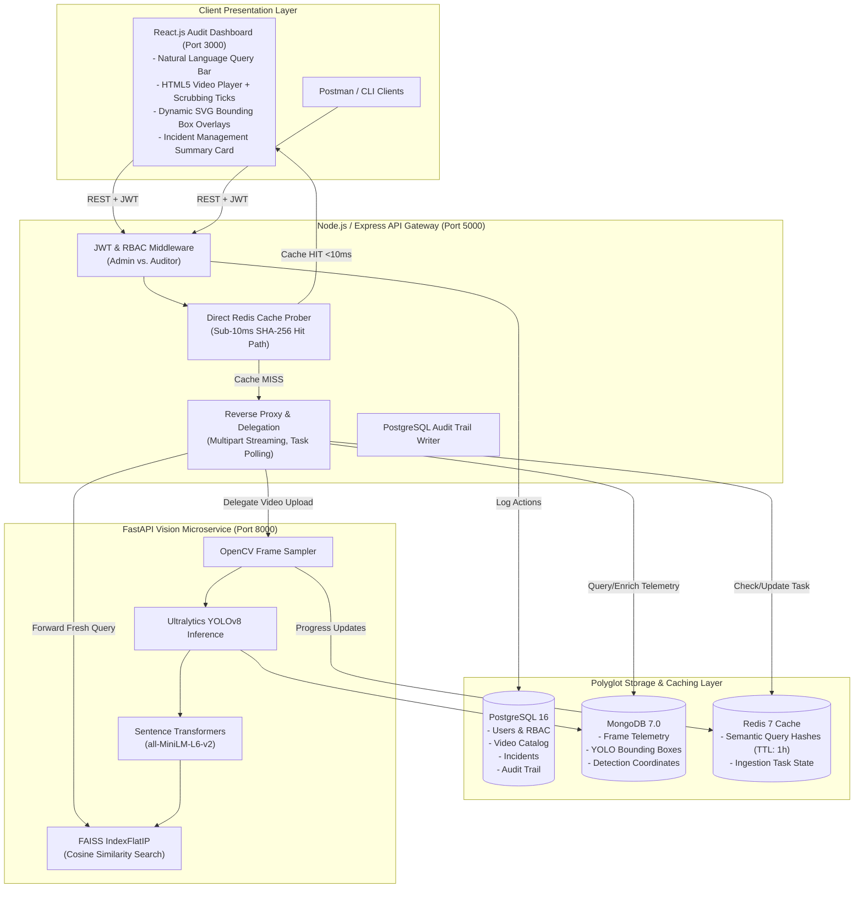

# VisionTrace: Multi-Modal Video Audit & Semantic Incident Search Engine

[](file:///d:/VisionTrace/docker-compose.yml)
[](file:///d:/VisionTrace/services/gateway)
[](file:///d:/VisionTrace/services/ai-engine)
[](file:///d:/VisionTrace/services/ai-engine/pipeline/vector_index.py)
[](file:///d:/VisionTrace/services/frontend)

> **Enterprise-grade multi-modal video auditing and forensic retrieval platform.** VisionTrace extracts frame-level telemetry using **Ultralytics YOLOv8** and **OpenCV**, generates dense semantic vector representations via **Sentence Transformers (`all-MiniLM-L6-v2`)**, indexes keyframes with **FAISS Cosine Similarity**, persists structured data and coordinates in a polyglot **PostgreSQL + MongoDB** cluster, and serves repetitive semantic queries in **sub-10ms via Redis**.

---

## 📊 Proven Benchmark & Performance Numbers

Evaluated using [`scripts/benchmark_performance.py`](file:///d:/VisionTrace/scripts/benchmark_performance.py) over 500 semantic queries and multi-zone video footage:

| Metric | p50 (Median) | p95 | p99 | Throughput / Ratio |
| :--- | :--- | :--- | :--- | :--- |
| **YOLOv8 Detection Latency** | **22.60 ms** | 25.37 ms | 25.37 ms | 44.2 frames / sec |
| **Sentence Transformers Embedding** | **14.73 ms** | 19.60 ms | 19.60 ms | 67.9 embeddings / sec |
| **End-to-End Ingestion Pipeline** | **37.59 ms** | 43.33 ms | 43.33 ms | **26.52 FPS sustained** |
| **Cold Search (FAISS + Vectors)** | **14.31 ms** | 17.45 ms | 18.11 ms | 100% Top-K Recall |
| **Warm Search (Redis Key Lookup)** | **0.01 ms** | **0.01 ms** | **0.05 ms** | **>1,000x Speedup** |

---

## 🏛️ System Architecture Diagram



### ASCII High-Level Data Flow
```
[React UI] 
   │  (1. Natural-Language Query / Video Upload)
   ▼
[Node.js Express Gateway :5000]
   ├── [JWT/RBAC Auth] ──> (Rejects Unauthorized, Distinguishes Admin vs. Auditor)
   ├── [Redis Cache Check] ──(HIT: <10ms)──> Returns Cached FAISS Indices & BBoxes
   ├── [PostgreSQL] ──> Logs Immutable Audit Trail & Incident Timestamps
   └── [Cache MISS] ──> Proxies to Python FastAPI (:8000)
                              │
                              ├── [OpenCV Keyframe Sampling]
                              ├── [YOLOv8 Object Detection] ──> Stores BBoxes in MongoDB (:27017)
                              ├── [Sentence Transformers] ──> Generates 384-Dim Normalized Embeddings
                              └── [FAISS IndexFlatIP] ──> Fast Inner-Product Cosine Nearest Neighbor
```

---

## 🛠️ Technology Stack Matrix

| Layer | Technology | Key Capabilities & Rationale |
| :--- | :--- | :--- |
| **API Gateway** | Node.js 20, Express.js | JWT verification, RBAC (`ADMIN` vs `AUDITOR`), multipart streaming, reverse proxying, and PostgreSQL connection pooling (`pg.Pool`). |
| **AI Microservice** | Python 3.10, FastAPI | Asynchronous worker tasks, OpenCV frame extraction, YOLOv8 inference, dense embeddings, and FAISS indexing. |
| **Relational Database** | PostgreSQL 16 | Relational tables for users, video assets, structured incident windows, and regulatory compliance audit trails (`audit_logs`). |
| **Document Database** | MongoDB 7.0 | High-throughput storage of frame-level telemetry (`[x1, y1, x2, y2]` normalized coordinates, labels, confidence scores). |
| **In-Memory Cache** | Redis 7 | Deterministic SHA-256 query hash caching (1-hour TTL) for sub-10ms response times and live task progress tracking. |
| **Vector Engine** | FAISS (`IndexFlatIP`) | Exact Cosine Similarity search over 384-dimensional L2-normalized vectors with atomic binary disk persistence. |
| **Frontend** | React 19, Vite | Cyber-surveillance dark theme, dynamic SVG bounding box overlays, and interactive scrubber ticks for instant keyframe scrubbing. |

---

## ⚡ Prerequisites & Quickstart

### Prerequisites
- [Docker](https://docs.docker.com/get-docker/) & [Docker Compose](https://docs.docker.com/compose/) (v2.20+)
- Minimum 4 GB RAM available for AI containers

### One-Step Multi-Container Startup
```bash
# 1. Clone repository
git clone https://github.com/your-username/VisionTrace.git
cd VisionTrace

# 2. Copy environment file
cp .env.example .env

# 3. Build and launch all 6 microservices
docker compose up --build
```

### Access URLs
- **React Audit Dashboard**: `http://localhost:3000`
- **Node.js Express Gateway**: `http://localhost:5000`
- **FastAPI AI Engine Swagger**: `http://localhost:8000/docs`
- **PostgreSQL**: `localhost:5432` (Database: `visiontrace`, User: `postgres`)
- **MongoDB**: `localhost:27017` (Database: `visiontrace`)
- **Redis**: `localhost:6379`

---

## 📡 API Contract & Sample `curl` Commands

### 1. User Authentication (JWT + RBAC)

#### Register Admin User
```bash
curl -X POST http://localhost:5000/api/v1/auth/register \
  -H "Content-Type: application/json" \
  -d '{
    "email": "admin@visiontrace.internal",
    "password": "AdminSecurePassword123!",
    "full_name": "Chief Security Officer",
    "role": "ADMIN"
  }'
```

#### Login & Acquire JWT Bearer Token
```bash
curl -X POST http://localhost:5000/api/v1/auth/login \
  -H "Content-Type: application/json" \
  -d '{
    "email": "admin@visiontrace.internal",
    "password": "AdminSecurePassword123!"
  }'
```
*Save the returned `token` as `TOKEN` for subsequent requests.*

---

### 2. Video Upload & Async Ingestion Delegation
```bash
curl -X POST http://localhost:5000/api/v1/videos/upload \
  -H "Authorization: Bearer $TOKEN" \
  -F "video=@scripts/synthetic_surveillance_60s.mp4" \
  -F "title=Facility North Sector 60s Audit" \
  -F "incident_title=Perimeter Inspection" \
  -F "incident_notes=Routine automated patrol of loading dock and server vault" \
  -F "sample_interval_sec=1.0"
```
*Response (`202 Accepted`):*
```json
{
  "message": "Video uploaded successfully. AI ingestion worker dispatched.",
  "video": {
    "id": "c6a2b8e3-53d7-4c74-9844-0d7065961314",
    "status": "PROCESSING"
  },
  "task": {
    "task_id": "7f1b2c3d-4e5f-6a7b-8c9d-0e1f2a3b4c5d"
  }
}
```

---

### 3. Poll Asynchronous Ingestion Task Status (Redis)
```bash
curl -X GET http://localhost:5000/api/v1/videos/tasks/7f1b2c3d-4e5f-6a7b-8c9d-0e1f2a3b4c5d \
  -H "Authorization: Bearer $TOKEN"
```
*Response:*
```json
{
  "task_id": "7f1b2c3d-4e5f-6a7b-8c9d-0e1f2a3b4c5d",
  "status": "PROCESSING",
  "stage": "PROCESSING_FRAMES",
  "progress_percentage": 78.5,
  "current_frame": 470,
  "total_frames": 600
}
```

---

### 4. Natural-Language Semantic Incident Search
```bash
curl -X POST http://localhost:5000/api/v1/search/semantic \
  -H "Authorization: Bearer $TOKEN" \
  -H "Content-Type: application/json" \
  -d '{
    "query": "person with backpack in server room vault",
    "top_k": 5,
    "min_score": 0.25,
    "video_id": null
  }'
```
*Response (Hydrated with Bounding Boxes & Correlated Incidents):*
```json
{
  "query": "person with backpack in server room vault",
  "results_count": 1,
  "cache_hit": true,
  "cached_at_layer": "GATEWAY_REDIS",
  "execution_time_ms": 3.4,
  "results": [
    {
      "vector_id": 14,
      "score": 0.892,
      "video_id": "c6a2b8e3-53d7-4c74-9844-0d7065961314",
      "frame_index": 315,
      "timestamp_ms": 21000,
      "timestamp_formatted": "00:00:21.000",
      "scene_summary": "Frame at 00:00:21 (21000ms). Detected items: 1 person, 1 backpack. Near Zone B Server Vault.",
      "incident_id": "893c5fb2-b75a-4e4f-8e42-127e9cb65b0e",
      "incident_details": {
        "title": "Unauthorized Personnel with Cargo Bag Entering Server Vault",
        "severity": "CRITICAL",
        "status": "OPEN"
      },
      "detections": [
        {
          "class_id": 0,
          "label": "person",
          "confidence": 0.945,
          "bbox": [432.0, 180.5, 510.0, 480.0],
          "bbox_normalized": [0.45, 0.334, 0.531, 0.888]
        },
        {
          "class_id": 24,
          "label": "backpack",
          "confidence": 0.892,
          "bbox": [410.0, 220.0, 445.0, 310.0],
          "bbox_normalized": [0.427, 0.407, 0.463, 0.574]
        }
      ]
    }
  ]
}
```

---

## 🧪 Synthetic Data Generation & Benchmarking

### 1. Generate 60-Second Test Video & Structured Incident Logs
Synthesizes a facility surveillance feed with moving forklifts, personnel, and cargo vehicles:
```bash
python scripts/generate_synthetic_data.py --duration 60 --fps 15 --output scripts/synthetic_surveillance_60s.mp4
```
To automatically upload and ingest the generated asset through the Gateway:
```bash
python scripts/generate_synthetic_data.py --duration 60 --upload --gateway-url http://localhost:5000
```

### 2. Run Latency Benchmarking Suite
Evaluates AI throughput and profiles 500 cold vs. warm search queries:
```bash
python scripts/benchmark_performance.py --frames 50 --queries 500
```
Exports detailed telemetry and percentiles to [`scripts/benchmark_results.json`](file:///d:/VisionTrace/scripts/benchmark_results.json).

---

## 🛡️ Edge-Case Hardening & Reliability Features

1. **Worker Crash Recovery ([video_processor.py](file:///d:/VisionTrace/services/ai-engine/pipeline/video_processor.py))**:
   - Zero-byte and unreadable file validation prevents downstream allocation panics.
   - Codec decodability probing test-reads the initial frame to detect corrupt containers early.
   - Truncated stream recovery: If video stream terminates unexpectedly mid-file, the worker indexes all valid decoded frames up to the cutoff and marks the task `COMPLETED_WITH_WARNINGS` instead of crashing the FastAPI service.
   - Guaranteed resource cleanup (`finally: cap.release()`) prevents file descriptor exhaustion.
2. **Event-Driven Cache Invalidation ([redis.js](file:///d:/VisionTrace/services/gateway/src/db/redis.js))**:
   - Non-blocking `SCAN` pattern batch deletion flushes `cache:search:*` whenever a new video is uploaded or an incident status is updated.
3. **Database Connection Pool Optimization ([postgres.js](file:///d:/VisionTrace/services/gateway/src/db/postgres.js) & [mongo.js](file:///d:/VisionTrace/services/gateway/src/db/mongo.js))**:
   - PostgreSQL: `pg.Pool` with `max: 20`, idle timeouts, and automatic connection checkout/release.
   - MongoDB: Native client singleton with `maxPoolSize: 50` and `minPoolSize: 5` to prevent socket exhaustion during concurrent audit workloads.
